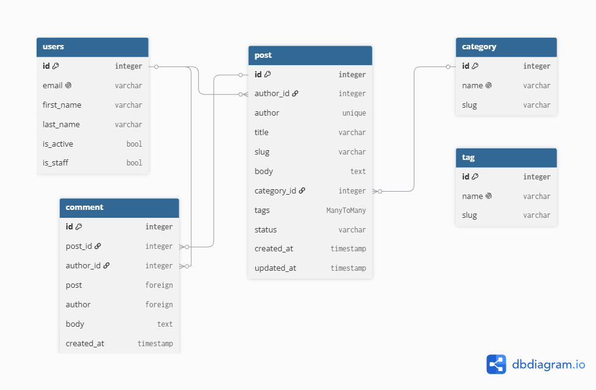

# Blog-api (homework1)

> A blog REST API bulit with Django and Django REST framework. Create custom user and blog models 

## Rules throughout the project:
- **PEP 8** — use a linter (`ruff` or `flake8`).
- **Constants** — no magic strings or numbers in code. Use constants.
- **Imports** — standard library + third party first, then django rest framework, then django, then local.
- **Naming** — `snake_case` for variables/functions, `PascalCase` for classes, `UPPER_CASE` for constants.
- **Type hints** — annotate function arguments and return types, e.g. `def get_posts_by_author(author_id: int) -> QuerySet[Post]`, `def create_user(email: str, password: str) -> User`.

## Project Structure
blog-api/
├── manage.py
├── .gitignore
├── README.md
├── requirements/
│   ├── base.txt      
│   ├── dev.txt         
│   └── prod.txt     
├── docs/
│   └── erd.png       # there we have erd diagram 
├── logs/              
├── apps/
│   ├── auths/          
│   └── blog/           
└── settings/
    ├── .env           
    ├── conf.py     
    ├── base.py         
    ├── urls.py
    ├── wsgi.py
    ├── asgi.py
    └── env/
        ├── local.py    
        └── prod.py    

## auths app contained from: 
- `email` — `EmailField(unique=True)`, primary login field
- `first_name` — `CharField(max_length=50)`, required
- `last_name` — `CharField(max_length=50)`, required
- `is_active` — `BooleanField`, default `True`
- `is_staff` — `BooleanField`, default `False`

## blog app contained from: 
**Category:**
- `name` — `CharField(max_length=100)`, unique
- `slug` — `SlugField(unique=True)`, URL-friendly identifier

**Tag:**
- `name` — `CharField(max_length=50)`, unique
- `slug` — `SlugField(unique=True)`

**Post:**
- `author` — `ForeignKey(User)`, `on_delete=CASCADE`
- `title` — `CharField(max_length=200)`
- `slug` — `SlugField(unique=True)`
- `body` — `TextField`
- `category` — `ForeignKey(Category)`, `on_delete=SET_NULL`, null allowed
- `tags` — `ManyToManyField(Tag)`, blank allowed
- `status` — `CharField`, use `TextChoices`: `draft`, `published`
- `created_at` — `DateTimeField`, auto-set on creation
- `updated_at` — `DateTimeField`, auto-set on save

**Comment:**
- `post` — `ForeignKey(Post)`, `on_delete=CASCADE`
- `author` — `ForeignKey(User)`, `on_delete=CASCADE`
- `body` — `TextField`
- `created_at` — `DateTimeField`, auto-set on creation

## What we learned from this practice:
- How to build models, how to write them from the scratch 
- How the project structure should be been (clear and understandable dir locations)
- How to build ERD diagram for better visualizing our project

